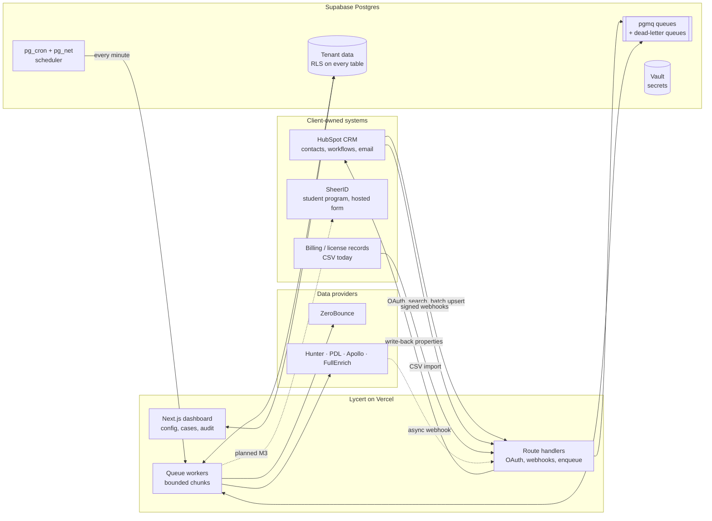

# Lycert

**Compliance intelligence and revenue recovery for education software licenses.**

Software companies give students heavily discounted "EDU" licenses. Many of those students graduate, start
working, and keep renewing at the student price for years. Lycert finds those accounts, estimates where each
student is in their education lifecycle, and drives a fair, auditable reverification and conversion process,
inside the CRM and verification tools the software vendor already uses.

This repository holds the full platform: a multi-tenant Next.js/TypeScript web app, a Postgres data model
with row-level security, durable queue workers, a deterministic scoring engine, a multi-provider data
enrichment waterfall, a HubSpot CRM connector, and a GDPR-oriented verification layer.

> **Snapshot note.** This is a curated public copy of a private development repository (about 200 commits,
> June to October 2026). Commit history was condensed into a fresh history so that client data, account
> identifiers and credentials from the working repository could not leak. Code, tests, migrations and
> specifications are unchanged apart from redactions, a few renamed identifiers, synthetic replacement
> values, and removed internal files: working status logs, agent scratch files, and the client's original
> script. The first client is referred to as "the design partner" throughout.

---

## Contents

1. [Status at a glance](#1-status-at-a-glance)
2. [The problem and the product](#2-the-problem-and-the-product)
3. [System architecture](#3-system-architecture)
4. [What is built, and how it was tested](#4-what-is-built-and-how-it-was-tested)
5. [Key architectural decisions](#5-key-architectural-decisions)
6. [Technology and services](#6-technology-and-services)
7. [Repository layout](#7-repository-layout)
8. [Running it locally](#8-running-it-locally)
9. [Testing strategy](#9-testing-strategy)
10. [Engineering process and my role](#10-engineering-process-and-my-role)
11. [Lessons learned](#11-lessons-learned)
12. [Roadmap](#12-roadmap)

---

## 1. Status at a glance

| Area | State | Evidence |
|---|---|---|
| Core platform: auth, multi-tenancy, scoring, dashboard, CSV import, case management, audit log, billing (test mode) | **Deployed to production** (June 2026), no paying customers yet | Unit + regression tests; manual acceptance on staging |
| Scoring engine | **Working**, byte-identical to the original reference engine | CEDS regression fixture passes in both TypeScript and Python |
| Enrichment waterfall + durable queue workers | **Working on staging** | Live batch of 24 real design-partner subscribers: 24/24 enriched and scored, 0 errors, 0 dead letters |
| HubSpot CRM connector (milestones M1 + M2) | **Working on staging, accepted** | Live tests against a HubSpot developer test account with 200 synthetic contacts and genuine HubSpot webhook traffic |
| Verification layer (email loop, document review with Claude vision, registrar stubs) | **Built and unit-tested, intentionally dormant** | Feature flags plus missing keys keep it inert until legal sign-off |
| SheerID connector (milestone M3) | **Next**, plan stage | Specified in `docs/architecture/LYCERT_BRIDGE_ARCHITECTURE.md` |
| HubSpot workflow actions (M4), design-partner pilot and production promotion (M5) | **Planned** | Same document, Part 12 |

| Test suite | Result |
|---|---|
| TypeScript unit tests (Vitest, 36 files) | 335 passing |
| Python tests (pytest), reference engine | 230 passing |
| TypeScript strict type check (`tsc --noEmit`) | Clean |
| End-to-end browser tests (Playwright) | Not written yet |

---

## 2. The problem and the product

### The business problem

A vendor of professional design software sells the same product at two prices: a full commercial price and a
large education discount. Eligibility is checked once, at signup, through a proof-of-enrollment document or a
verification provider. After that, renewals often continue automatically. Graduates who now work at
architecture firms or agencies keep paying the student price. The revenue loss is real, but the vendor's
compliance team has no scalable way to find these accounts. They also cannot act on suspicion alone without
creating legal and reputational risk.

### What Lycert does

1. **Mirrors** the vendor's EDU customers from their CRM (HubSpot today, CSV import as a fallback).
2. **Estimates** each subscriber's graduation status from the data the vendor already holds: stated
   graduation date, renewal timing, institution, email domain, location consistency.
3. **Enriches** selected subscribers with public professional signals (current employer, job title,
   education end date) through a cost-aware waterfall of data providers.
4. **Scores** each account with a deterministic, explainable model of 11 signals in three tiers. Every point
   carries a human-readable reason, and missing data is never held against the subscriber.
5. **Decides** who is due for reverification or a graduate offer, and when.
6. **Activates** through the vendor's own systems. Lycert writes properties back to HubSpot contacts so the
   vendor's existing marketing automation sends the email. It then routes students into the vendor's own
   verification provider (SheerID) through a tracked link.
7. **Keeps a human in the loop.** Adverse outcomes are never automated. Cases go to a reviewer, review time
   is recorded, and every action lands in an append-only audit log.

### The pivot: from verifier to orchestrator

The first design had Lycert own authoritative enrollment verification itself, through registrar
clearinghouses, an email-ownership loop, and AI-assisted document review. That layer was built (section 4.5),
but authoritative sources require a registered legal entity, reference customers, legal review, and per-check
fees. Vendors also already pay a verification provider for exactly this job.

In October 2026 the product was re-architected around **"the Bridge."** Lycert stopped trying to own
verification data. It became the intelligence and orchestration layer between three systems the client already
pays for: their CRM, their verification provider, and their billing records. The verification layer was
frozen behind flags rather than deleted, so a future segment of clients without a verification provider can
still use it.

---

## 3. System architecture



### Design principles

- **No long-running work in a request handler.** Route handlers authenticate, validate and enqueue. All
  enrichment, scoring, CRM sync, verification and write-back runs in workers that drain one bounded chunk
  per invocation. `pg_cron` schedules them inside Postgres, and `pg_net` calls them over HTTP. Postgres is
  the single source of truth for job state.
- **Pure core, injected I/O.** Each subsystem splits a pure orchestration module (`worker.ts`, `cascade.ts`,
  `orchestrator.ts`) from an I/O binding (`worker-io.ts`). Retry, checkpoint, dead-letter and legal rules
  are unit-tested with in-memory fakes, without a database, network or provider account.
- **Multi-tenant by construction.** Every table has row-level security from its creating migration. A
  Supabase custom access-token hook puts the tenant and application role into the JWT. Policies scope every
  read and write to the caller's tenant.
- **Determinism and auditability.** The scoring engine takes an explicit reference date, never "now". The
  same inputs on the same date always produce the same score. `subscriber_scores` and `audit_logs` are
  append-only.
- **Legal rules live in code, not in a policy document.** Missing data scores zero and is recorded as a data
  gap. A non-authoritative source can never assert "not enrolled". The orchestrator downgrades such a claim
  to "unable to confirm". Consent is checked before any consent-requiring provider runs.

### Queue runtime

| Queue | Purpose | Dead-letter queue |
|---|---|---|
| `enrichment_jobs_q` | Per-subscriber enrichment waterfall | `enrichment_dlq` |
| `scoring_q` | Re-score after enrichment or verification changes | `scoring_dlq` |
| `crm_sync_q` | HubSpot bootstrap, backfill, webhook events, nightly reconcile, write-back | `crm_sync_dlq` |
| `verification_q` | Verification waterfall and reverification cadence | `verification_dlq` |

The workers rely on pgmq's visibility-timeout contract. A transient failure leaves the message alone, and it
reappears for retry. A message whose read count passes a threshold moves to the dead-letter queue *before*
another attempt, so a poison message cannot re-charge paid providers forever. Each attempt saves its merged
result and the list of providers already tried *before* archiving the message. A retry therefore resumes the
waterfall where it stopped, and a provider is charged at most once per subscriber.

---

## 4. What is built, and how it was tested

The labels below are deliberately strict. **Live-verified** means exercised end to end against real
third-party systems on the staging environment. **Unit-tested** means covered by automated tests with faked
I/O, but not run against the real service. **Dormant** means built and tested, but switched off on purpose.

### 4.1 Core platform (production, June 2026)

- Email/password auth with Supabase Auth and middleware session refresh, plus self-serve onboarding with a
  mandatory Data Processing Agreement step. The dashboard is gated until a DPA signatory is recorded.
- Multi-tenant schema with roles (owner, admin, manager, reviewer, viewer) carried in the JWT.
- Subscriber list, search, detail view with tabs, soft-archive and restore, and owner-only hard purge.
  Every one of these actions is audited.
- CSV import wizard. Imports run in 500-row batches with a progress bar. Column mapping goes through a
  per-tenant field-mapping layer, so each vendor's column names map onto canonical fields. Dates are parsed
  with per-column day/month order inference, and source files with broken encoding are detected at upload.
- Case management: assignment, comments, decisions with recorded review duration, and escalation.
- Audit log viewer with CSV export.
- Stripe billing in test mode: checkout, customer portal, and a signed webhook.
- Lifecycle engine that places every subscriber in one of eight lifecycle stages from their graduation data.

*Tested by:* unit tests, plus manual acceptance on staging with seeded synthetic tenants.

### 4.2 Scoring engine

- Eleven signals in three tiers. Tier A covers renewal and subscription timing against the stated graduation
  date. Tier B covers email domain, institution quality and country consistency. Tier C covers professional
  signals from enrichment.
- Post-processing rules, exculpatory signals (for example, a current student title, or an academic employer
  domain), confidence tiers and recommended actions.
- Per-tenant weight overrides, layered field by field over the default configuration.
- An optional verification signal. A confirmed enrollment caps suspicion below Tier 2. A confirmed
  non-enrollment routes the case to human review, never to automatic action. An absent result changes
  nothing.

The engine began as a single-file Python script (CEDS) written for the design partner. It was ported first to
a FastAPI service and then to TypeScript. The TypeScript port is the production runtime.

*Tested by:* per-signal unit tests for every branch, data-gap cases and exculpatory cases. A **regression
gate** runs the synthetic reference accounts through both the TypeScript and Python engines and requires
identical total scores and tiers to the reference engine's output.

### 4.3 Enrichment waterfall (staging)

A registry-driven cascade stops at the first provider that returns enough data:

```
Stage 0  ZeroBounce validation (cached 180 days; blocks only disposable mailboxes)
   │
   ├─ Hunter        (cheap, corporate domains)
   ├─ PDL           (profile data, strongest on education history)
   ├─ Apollo        (gap-fill, enabled only with a paid key)
   └─ FullEnrich    (async: submit → webhook or 15-minute poll reconcile; reaches personal emails)
```

- A **free pre-enrichment layer** runs at import time and costs no credits. It normalizes institution names,
  cleans locations, classifies email domains against an academic-domain table (including subdomains such as
  `edu.school.ca`), and computes an enrichment priority so paid credits go where they matter.
- A **merge engine** sets field-level precedence. The first writer wins, except that PDL overrides education
  fields. Employment dates merge only for the same employer. Results whose name has zero token overlap with
  the subscriber are discarded as a mismatched person. Every field records which provider supplied it.
- **Budget controls**: a per-tenant monthly credit budget, per-provider credit tracking, job-level stats, and month-to-date
  spend shown in the UI.
- **Benchmarks before integration.** Providers were measured on a ground-truth sample with known correct
  answers before they entered the cascade. On a 20-row paid sample, FullEnrich resolved 50% of subscribers and PDL 20%. Three
  EU-based providers were built against their real APIs. On the hard population of international students
  with personal emails, they added almost nothing: one hit in 20, or company data only. They were kept out of
  the cascade.

*Tested by:* unit tests for cascade construction, merge rules, mappers, checkpoint and retry semantics.
**Live-verified** on staging: a 24-subscriber batch of real design-partner records ran 24/24 with no errors or
dead letters. The FullEnrich async path (submit, finish, poll-reconcile, merge, re-score) was verified on a
real record. That run found and fixed a real bug: the async merge had never written its result because an
upsert omitted a required tenant column.

### 4.4 HubSpot CRM connector (staging, milestones M1 and M2 accepted)

- A HubSpot app built on HubSpot's Projects platform, with OAuth install, encrypted token storage and
  refresh, and an HMAC-signed `state` parameter.
- **Idempotent property bootstrap.** A "Lycert" property group is created on the contact object, and
  running it again creates nothing. Conflicting existing properties are detected rather than overwritten.
- **Segment configuration** that marks which contacts are EDU, plus an inbound field mapping. Both are
  tenant configuration, not hardcoded values.
- **Initial backfill** through the CRM Search API, page by page on the queue. It feeds the subscriber mirror
  and a contact-link table.
- **Write-back** of estimated graduation date, lifecycle stage, education status, conversion score,
  recommended offer and last-synced time. Writes are batched in groups of 100 and **diffed by hash**, so
  unchanged contacts are never rewritten.
- **Webhooks**: v3 signature validation (HMAC-SHA256 over method, exact target URL, raw body and timestamp,
  with a constant-time compare and a five-minute replay window). Events are enqueued and never processed
  inline.
- **Nightly reconcile** that sweeps contacts modified since a stored watermark, so missed webhooks are
  repaired.
- **Deletion handling** that removes the mirror when a contact is deleted in HubSpot.
- **Rate limiting** that keeps API usage under each portal's budget.

*Tested by:* 81 unit tests in `apps/web/lib/crm/`. **Live acceptance** on a HubSpot developer test account
seeded with 200 synthetic EDU contacts covered install, a single property creation, all 200 mirrored, fields
written back and visible in a HubSpot list filtered on Lycert properties. Then real HubSpot webhooks for
create, property change and delete round-tripped through the queue. Two real bugs were found and fixed during
these live tests (section 11).

### 4.5 Verification layer (built, dormant)

An authoritative "is this person still enrolled?" layer, kept separate from enrichment's indicative signals:

- A **provider interface and waterfall orchestrator** that enforces method availability, a consent gate
  (skip, not fail), stop-on-terminal, and the **asymmetry invariant**: only providers flagged as authoritative
  may ever assert "not enrolled".
- **Email-ownership loop**: matches the institutional domain, issues a single-use expiring challenge, and
  resolves it on click. Sending needs both an API key and an explicit flag. Personal emails are never mailed,
  and there is no batch send.
- **Hosted consent flow**: a public page with a stateless HMAC-signed link token, recording a five-field
  consent record modelled on FERPA requirements.
- **Document review pipeline**: classify and extract with a Claude vision model through structured outputs.
  Data minimization is enforced twice. The prompt forbids transcribing ID numbers, dates of birth or
  addresses, and the output schema has no fields to hold them. Confidence is capped at "medium", there is
  no auto-approval, and every document goes to a human review queue. Raw files sit in a private storage
  bucket and are purged within 24 hours. Exact-file reuse is detected by hash.
- **Registrar clearinghouse stubs** (US National Student Clearinghouse, UK HEDD) that never confirm or
  refute anything.
- **Reverification cadence** in the lifecycle engine: expired verifications re-enter the queue.

*Tested by:* unit tests for orchestrator invariants, consent gating, token signing, challenge resolution,
the document pipeline and purge selection. **Not live.** It stays off until there is a data protection impact
assessment, sub-processor agreements and counsel-reviewed consent text. Under the Bridge roadmap it is frozen.

### 4.6 Python service (reference oracle)

`apps/api` is the FastAPI service from the first phase: auth middleware, scoring, cases, lifecycle, and the
first version of the enrichment waterfall. Railway hosted it, and the host proved unreliable for long jobs
(section 11). The runtime was consolidated on TypeScript. The Python engine is kept with its 230 tests as an
independent parity oracle for the scoring port.

---

## 5. Key architectural decisions

Each of these was recorded with its alternatives and reasons at the time. A condensed log is in
[`docs/decisions.md`](docs/decisions.md).

| Decision | Why |
|---|---|
| **Durable queue in Postgres (pgmq + pg_cron + pg_net)** instead of serverless functions or a separate job host | Long, stateful jobs on an unsuitable host were what failed first. A Vercel function hits the same timeout wall at scale while passing every small test. Keeping the queue in Postgres added no new vendor and gave transactional job state. |
| **One engine, in TypeScript**, Python kept only as an oracle | Two engines drift. Parity was made non-negotiable: the regression must pass on the TypeScript engine before the Python runtime could be retired. |
| **GDPR as the governing framework**, with a human in the loop as a legal requirement | Scoring individuals for possible misuse is profiling under Article 22. Adverse decisions require human review, and the product design follows from that. |
| **Missing data is never penalized** | A legal and fairness requirement. Absent data scores zero and is reported as a data gap, so a sparse record never looks suspicious. |
| **Asymmetry invariant** | Indicative sources can raise a question but can never close one against the subscriber. Only an authoritative source may assert "not enrolled". |
| **Benchmark before integrating a provider** | Three providers were fully built, measured on known-answer samples, and kept out of the cascade when they added almost no coverage. Paid plans were not bought on vendor claims. |
| **ZeroBounce blocks only disposable mailboxes, not "invalid" ones** | Student mailboxes are often deactivated after graduation. An "invalid" address is itself a graduation signal, so blocking it would discard the most useful records. |
| **Orchestrate the client's systems instead of owning verification** (the Bridge) | Authoritative registrar access needs agreements, a legal entity and per-check fees. Clients already pay a verification provider. Writing into the CRM they already use is a faster path to adoption. |
| **Just-in-time verification links** | The SheerID verification is created only when the student clicks, so non-responders cost the client nothing and abandoned verifications do not expire unused. |
| **Least privilege for SheerID** | Lycert correlates results through its own opaque reference and never requests the personal-data role. |
| **Freeze, don't delete** | Superseded subsystems stay in the codebase, tested and switched off by flags. Migrations are never edited or dropped. |

---

## 6. Technology and services

| Layer | Technology |
|---|---|
| Web application | Next.js 14 (App Router, Server Components, Server Actions), React 18, TypeScript in strict mode, Tailwind CSS, react-hook-form + zod |
| Database | PostgreSQL on Supabase (EU region): row-level security, a custom access-token hook, Storage for private document storage, Vault for secrets |
| Jobs | pgmq (Supabase Queues), pg_cron, pg_net |
| Hosting | Vercel: preview deployments per branch, deployment protection with an automation bypass |
| Reference service | Python 3.11, FastAPI, Pydantic v2, pandas/openpyxl, pytest. Formerly hosted on Railway. |
| CRM | HubSpot: Projects platform and CLI, OAuth 2.0, CRM v3 Search, Batch and Properties APIs, v3 webhook signatures |
| Verification | SheerID (planned M3); email loop through Resend; Anthropic Claude vision for document classification and extraction |
| Data providers | ZeroBounce, Hunter, People Data Labs, Apollo, FullEnrich; evaluated and excluded: Datagma, ReverseContact, Findymail, Icypeas, Dropcontact |
| Payments | Stripe (test mode) |
| DNS and domains | Cloudflare |
| CI | GitHub Actions: Python tests, TypeScript type check, Vitest |
| Testing | Vitest, pytest, a cross-engine regression fixture |
| AI-assisted development | Claude Code with project rules (`docs/engineering-process/CLAUDE.md`) and MCP servers for Supabase, Vercel and HubSpot |

**Infrastructure separation.** Staging and production are fully separate: two Supabase projects, separate
Vercel environments, separate HubSpot apps and credentials, and Stripe test keys only. Branches follow
`develop` (local), then `staging` (auto-deployed preview), then `main` (production, released by hand).

---

## 7. Repository layout

```
.
├── apps/
│   ├── web/                    Next.js application: UI, API routes, all runtime logic
│   │   ├── app/                Routes: (auth), (onboarding), (dashboard), (verify), api/
│   │   ├── components/         UI components
│   │   └── lib/
│   │       ├── crm/            HubSpot connector: client, webhooks, sync worker, write-back
│   │       ├── enrichment/     Waterfall cascade, providers, merge, queue workers
│   │       ├── scoring/        Scoring engine, signals, field mapping, regression fixture
│   │       ├── verification/   Orchestrator, providers, consent, document pipeline
│   │       └── supabase/       Server and browser clients
│   └── api/                    FastAPI reference implementation (parity oracle)
├── supabase/
│   ├── migrations/             47 ordered SQL migrations (schema, RLS, queues)
│   └── seed/                   Synthetic staging seed data
├── integrations/hubspot-app/   HubSpot project: app definition and webhook subscriptions
├── scripts/                    Benchmark and fixture-building scripts
├── docs/
│   ├── architecture/           Product and system specifications
│   ├── compliance/             Draft consent text for the verification flow
│   ├── engineering-process/    How the project was built with an AI coding agent
│   ├── reference/              Synthetic fixtures for the scoring regression
│   └── decisions.md            Condensed architecture decision log
└── .github/workflows/ci.yml
```

Each top-level folder has its own README.

---

## 8. Running it locally

Prerequisites: Node.js 20+, Python 3.11+, and a Supabase project (the free tier is enough).

```bash
# Database
supabase link --project-ref <your-project-ref>
supabase db push                       # applies supabase/migrations in order

# Web app
cd apps/web
cp .env.local.example .env.local       # fill in your Supabase URL and anon key
npm install
npm run dev                            # http://localhost:3000
npm test                               # Vitest
npm run type-check

# Reference service (optional)
cd apps/api
pip install -r requirements.txt
pytest
```

The core app needs only the Supabase variables. Each external integration activates only when its own key
is present, and stays inert otherwise. That covers enrichment providers, HubSpot, Stripe, Resend and
Anthropic. Some also need an explicit feature flag. The full list is in `.env.example`.

---

## 9. Testing strategy

- **Pure-core unit tests.** Orchestration logic is written against injected interfaces. Retries, dead-letter
  routing, checkpoint resume, merge precedence, signature validation and the legal invariants are all
  tested without network or database.
- **Cross-engine regression gate.** The same synthetic accounts run through the Python reference engine and
  the TypeScript port, and the scores must match exactly. Any change to scoring output fails this test.
- **Contract checks against live documentation.** External API shapes were confirmed against each vendor's
  current documentation before code was written, and each confirmation was logged. They include the HubSpot
  token endpoint, signature scheme and webhook payloads, and the provider endpoints.
- **Live acceptance tests per milestone.** Each milestone ends with a run against real third-party systems on
  staging, using synthetic data, followed by an eyes-on review in the third party's own UI.
- **Known gaps.** There is no automated database integration harness yet. One real pagination bug passed
  the fake-I/O tests and was caught only in a live run (section 11). Playwright end-to-end tests are planned
  but not written.

---

## 10. Engineering process and my role

**Joshua Mwesigwa, founder (Aethric Group LLC).** I own Lycert end to end:

- **Product and domain.** I identified the problem with the design partner, defined the product, and led the strategic pivot from verifier to orchestrator when the economics of owning
  verification did not hold.
- **Architecture and specifications.** I own the system specifications in `docs/architecture/`. They cover the
  data model, legal spine, queue architecture, enrichment waterfall, verification layer and the Bridge
  roadmap. Each milestone was planned against them before any code was written.
- **Decisions.** Every architecture decision with a legal, cost or product consequence went through me:
  provider selection, data-retention rules, what to freeze, what to drop, and when to promote.
- **Infrastructure and vendors.** I set up and operate the Supabase, Vercel, HubSpot developer, Cloudflare,
  Stripe and data-provider accounts. I chose which providers to benchmark, set the budgets, and decided
  what entered the cascade. I own the legal workstreams (DPA, consent, sub-processors).
- **Acceptance testing.** No milestone closed on passing tests alone. I signed off each one after checking
  the outcome myself in the real system, for example confirming the 200 synced contacts in HubSpot's own UI.

**How the code was written.** The implementation was produced with an AI coding agent, Claude Code, working
under my direction inside a deliberately structured workflow. Designing that workflow was a central part of
the project:

- A rules file (`docs/engineering-process/CLAUDE.md`) sets non-negotiable constraints. Production releases
  are mine alone. Tests run before every push. New environment variables are tracked. Migrations are never
  edited after they run. The agent must stop and ask before any decision with legal, schema, scoring or
  security consequences.
- A **milestone gate**: plan, my approval, build, live verification, my acceptance. The agent may not start
  the next milestone until I have accepted the previous one.
- **Living project state.** Status, next steps and a decision log were updated at the end of every session,
  so any session could resume with full context.
- **Tool access through MCP servers** (Supabase, Vercel, HubSpot), so the agent could apply migrations,
  inspect deployments and read runtime logs directly. Destructive operations stayed with me. One example:
  the agent gave me the exact DNS record to add instead of rewriting a live zone file.
- **Honest reporting.** Failed and unresolved results were recorded as failed and unresolved, and corrected
  when the real cause was found.

More detail: [`docs/engineering-process/README.md`](docs/engineering-process/README.md).

---

## 11. Lessons learned

**1. A webhook that "never arrives" may be rejected before your code runs.** HubSpot reported a 401 on every
webhook delivery. The first fix addressed a real but secondary bug: the signature was computed over the
URL as the serverless function saw it (`http://`) instead of the exact `https://` URL HubSpot signs. The
401s continued. The decisive clue was an absence. Vercel logs every function invocation whatever its status,
and there was no log line at the delivery minute. So the request was being rejected at the edge. Vercel's
deployment protection covered preview URLs, and HubSpot cannot send a bypass header. Our own test calls had
always included that header, which is why they all passed. A custom domain alone did not help either,
because it mapped to a preview deployment. The fix was Vercel's documented automation-bypass parameter in
the configured target URL. Also, the nightly reconcile had been quietly repairing the data the failed
webhooks missed, which made an early "pass" look real. **Takeaways:** test each delivery path in isolation;
read infrastructure logs for what is missing, not only for errors; and remember that a test harness that
sends privileged headers does not prove an external caller will get through.

**2. Fake-I/O tests prove the logic, not the query.** With 200 contacts, the write-back worker processed the
first 100, then fetched the same 100 forever. The database query had no filter or cursor for rows already
written. The pure orchestration was correct, and its tests passed because the fake returned a fixed array.
The live acceptance run caught it. Any tenant with more than 100 EDU contacts would have hit it.

**3. Don't run stateful batch jobs on request-response infrastructure.** The first Python host returned
recurring 502s on long enrichment jobs. The fix was architectural rather than a language change. Jobs moved
to a Postgres queue with bounded chunks, checkpointing and a dead-letter queue, all designed so a retry never
pays a provider twice.

**4. Measure before you buy, and distrust a zero.** Three data providers, each a plausible fit on paper, were
built against their real APIs and benchmarked. They added almost no coverage on the population that
mattered. One early "0 of 5" result was partly caused by our own mapper, which dropped fields the provider
really did return. Benchmarking exposed that bug, a wrong authentication header for another provider, and
a wrong poll endpoint, all before any of it reached production.

**5. Auth claims can collide with database roles.** The first custom access-token hook wrote the app role
into the JWT's `role` claim. PostgREST uses that claim to `SET ROLE`, so every REST call returned 401. Moving
the app role to a separate `user_role` claim fixed it.

**6. "Verified" is not "resolving".** A subdomain showed as verified in the hosting dashboard but returned
NXDOMAIN. The status reflected ownership of the apex domain, not the existence of the record. Check DNS
directly.

**7. Make CI check what the build doesn't.** `next build` skips test files, but `tsc --noEmit` checks them.
Type errors in three test files kept the TypeScript CI job red for several pushes while every local build
passed. CI now also runs the full Vitest suite.

**8. Product lesson: the fastest route to value goes through the customer's existing tools.** The first
architecture was technically sound, but it asked clients to adopt a new verification authority and a new
workspace. Re-centering on the CRM and verification provider they already pay for removed most of the
adoption friction, the legal agreements and the per-check costs. The cost was freezing months of verification
work. Because the work was frozen rather than deleted, it stays available for clients who have no
verification provider.

---

## 12. Roadmap

| Milestone | Scope | State |
|---|---|---|
| M0 | Lock the Bridge direction, freeze superseded subsystems behind flags | Done |
| M1 | HubSpot connector foundation: OAuth, properties, segment, backfill, write-back | Done, accepted |
| M2 | Webhooks, nightly reconcile, deletion, expanded write-back, enrichment trigger | Done, accepted |
| **M3** | **SheerID connector**: provider-connection tables, dual credential support (OAuth client credentials and static token), outcome mapping as a pure function, a mock SheerID server covering every Test Mode outcome for CI, just-in-time redirect links, polling ingestion, plus live tests against a SheerID Test Mode program behind a flag | Next |
| M4 | HubSpot custom workflow actions ("issue reverification link" and others) and client setup guides | Planned |
| M5 | Design-partner pilot on a small segment with daily caps; production promotion of the staging migrations with a written runbook and rollback plan | Planned |

Deferred until the HubSpot and SheerID loop works in production: a Salesforce connector, more verification
providers through the same adapter pattern, HubSpot app cards and timeline events, SSO, and a public API.

---

*© 2026 Aethric Group LLC. Source shared for review purposes. See [LICENSE](LICENSE).*
